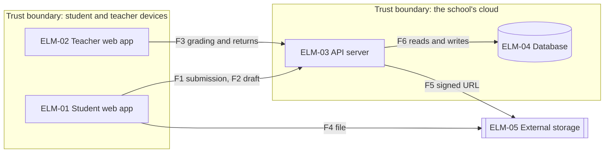
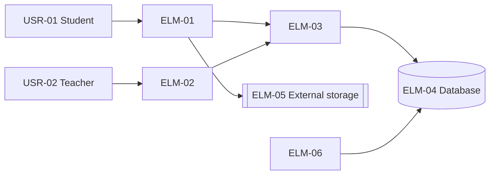
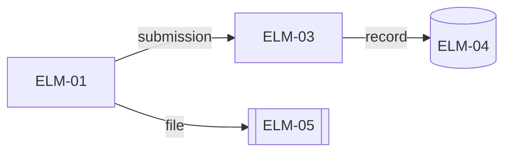
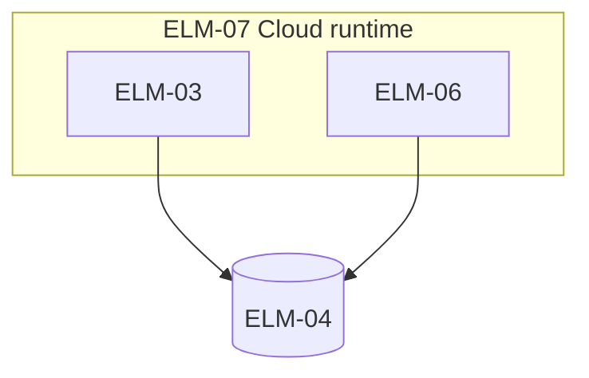
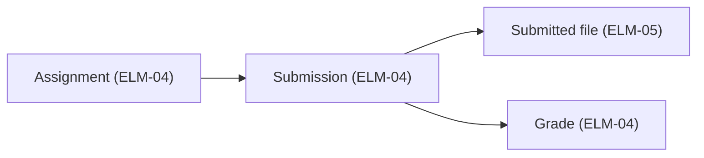

# Architecture: Homework submission service

Status: answers applied · Updated: 2026-09-18 · Inputs as of: none · Stage 2 of 4

## Summary

One API server and two web apps; files go straight to the storage.

## Inputs
| Source | What it gave |
|---|---|
| 1-architecture-drivers.md | The drivers and their ranking |

## Overall structure

One API server (ELM-03) takes requests from the two web apps (ELM-01, ELM-02). Submitted files go straight to the external storage (ELM-05) through signed URLs (DEC-02).

DEC-01 How the system is divided:
| Driver (rank) | One API server, and web apps for students and teachers | A service per function | Serverless functions |
|---|---|---|---|
| DRV-01 (1) | Meets | Meets | Meets |
| DRV-06 (5) | Meets | Fails | Partly |

## Design decisions
<!-- generated: decisions -->
| DEC | Title | Addresses | Basis |
|---|---|---|---|
| DEC-01 | One API server and two web apps | DRV-06, DRV-01, DRV-04 | assumed |
| DEC-02 | Upload files straight to the storage with signed URLs | DRV-01, DRV-05, DRV-02 | inferred |
| DEC-03 | Write the record before showing the receipt | DRV-03, DRV-09 | inferred |
| DEC-04 | Build the nightly report in a batch | DRV-06, DRV-03 | inferred |
| DEC-05 | The browser creates the trace ID and passes it on | DRV-07 | inferred |
| DEC-06 | The parents' screens go in the students' web app | DRV-04, DRV-06 | inferred |
<!-- /generated -->

DEC-02 How files are stored:
| Driver (rank) | Direct upload with a signed URL | The server receives and stores the file |
|---|---|---|
| DRV-01 (1) | Meets | Fails |

## Design concerns
| Concern | Settled by, left to a later stage, or why standard practice is enough |
|---|---|
| Concurrency | Retried submissions are made one by idempotency keys (stage 3 decides how) |
| Data persistence | The record and the receipt are written in one transaction (DEC-03, after FND-01) |
| Error handling and fault tolerance | On a storage outage, submissions stop and ask to try again |
| Variability | The parents' screens are added to the students' web app (DEC-06) |

## Threat model

Assets: students' answers, submission records, grades.

| Flow | Crosses | Spoofing | Tampering |
|---|---|---|---|
| F1 | device → school cloud | Submitting as someone else: session (DEC-01) | Changing the deadline: the server decides |
| F2 | device → school cloud | Reading someone else's draft: owner only (DRV-08) | — |
| F3 | device → school cloud | A teacher who does not teach the class grades: the class is checked (FND-02) | Changing a grade: it is recorded |
| F4, F5 | device and school cloud → external service | Uploading with a stolen URL: 15-minute expiry (DEC-02) | — |
| F6 | inside the school cloud | — | — |

## Elements
<!-- generated: elements -->
| ELM | Name | Kind | Team | As-is |
|---|---|---|---|---|
| ELM-01 | Student web app | component | TEAM-01 | new |
| ELM-02 | Teacher web app | component | TEAM-01 | new |
| ELM-03 | API server | component | TEAM-01 | new |
| ELM-04 | Database | data store | TEAM-01 | new |
| ELM-05 | External storage | data store | — | new |
| ELM-06 | Nightly batch | component | TEAM-01 | new |
| ELM-07 | Cloud runtime | node | TEAM-01 | new |
<!-- /generated -->

## Views

### Context

### Runtime

| Connector | Style | Who waits for whom |
|---|---|---|
| ELM-01 → ELM-03 | Request and response | ELM-01, up to 10 s |
| ELM-03 → ELM-04 | Request and response | ELM-03, up to 2 s |

### Deployment

### Information

## Walkthroughs

### CUJs

**CUJ-01 Submit homework**
| Step | FR | Elements | Interactions | Gap |
|---|---|---|---|---|
| Open the assignment | FR-01 | ELM-01, ELM-03 | ELM-01 → ELM-03 gets the assignment | none |
| Attach a file | FR-01 | ELM-01, ELM-05 | ELM-01 → ELM-05 upload with a signed URL | none |
| Submit | FR-01, FR-02 | ELM-01, ELM-03, ELM-04 | ELM-03 writes the record and returns the receipt | none |

**CUJ-02 Grade and return**
| Step | FR | Elements | Interactions | Gap |
|---|---|---|---|---|
| Open the submission | FR-03 | ELM-02, ELM-03, ELM-05 | ELM-02 → ELM-03 list and contents | none |
| Grade | FR-03 | ELM-02, ELM-03 | Saves the grade | none |
| Return | FR-03, FR-08 | ELM-02, ELM-03 | Returns and notifies | none |

**CUJ-03 Investigate a failed submission**

The developer who gets the notice traces the logs with the trace ID and fixes the cause (DEC-05). Too few steps for a table.

**CUJ-04 Check monthly submissions**
| Step | FR | Elements | Interactions | Gap |
|---|---|---|---|---|
| Open the report | FR-05 | ELM-02, ELM-03, ELM-06 | The report up to the previous day | none |

### Primary drivers
| DRV | Where the stimulus enters | Decisions that shape the response | Meets the measure? | Remaining risk |
|---|---|---|---|---|
| DRV-01 | ELM-03 | DEC-01, DEC-02 | Likely | A storage outage |
| DRV-03 | ELM-03 | DEC-03 | Yes | None |
| DRV-05 | ELM-01 | DEC-02 | Yes | None |
| DRV-02 | ELM-03 | DEC-03 | Likely (stage 3 budget) | A slow write |

## Design parameters
<!-- generated: parameters -->
| Parameter | DEC | Decided in |
|---|---|---|
| Signed URL expiry | DEC-02 | DEC-02 |
| Batch start | DEC-04 | DEC-04 |
<!-- /generated -->

## Debt and deferrals
| Item | Debt, or deferral of a full-depth kind | Decided in |
|---|---|---|
| DEC-04 | Debt: The report only covers up to the previous day | DEC-04 |
| HND-02 | Deferral: the layout of the parents' screens | DEC-06 |

## Cost and team
| Cost driver | Usage | Price |
|---|---|---|
| Runtime | One, always | 10,000 yen a month |
| Storage | 50 GB a year | 2,000 yen a month |

- Two developers can build it (PC-03).

## Findings
<!-- generated: findings -->
| FND | Title | Severity | Raised by | To | Status | Items changed |
|---|---|---|---|---|---|---|
| FND-01 | The receipt is shown before the record is written | major | design-review | architecture-drivers-to-architecture | accepted | DEC-03 |
| FND-02 | No trace ID is passed on | minor | design-review | architecture-drivers-to-architecture | accepted | DEC-05 |
<!-- /generated -->

## Hand-offs
<!-- generated: handoffs -->
| HND | Title | From | To | Component | Status | Decided in |
|---|---|---|---|---|---|---|
| HND-02 | The layout of the parents' screens | architecture-drivers-to-architecture | high-level-design-to-detailed-design | ELM-01 | open | — |
<!-- /generated -->

## Decisions
| # | Question | Answer | Items |
|---|---|---|---|
| 1 | Where is the trace ID created? | The browser (as drafted) | DEC-05 |

## Open assumptions
<!-- generated: assumptions -->
| ID | Title | Kind | Breadth | Severity | Items that depend on it |
|---|---|---|---|---|---|
| DAS-01 | At most 300 students at once | judgment | medium | low | DEC-01 |
<!-- /generated -->

## Placeholders

None.

## Open gaps

None.

## Out of scope

The content of the parents' screens (CHG-01).

## Next

Run architecture-to-technical-policy.
