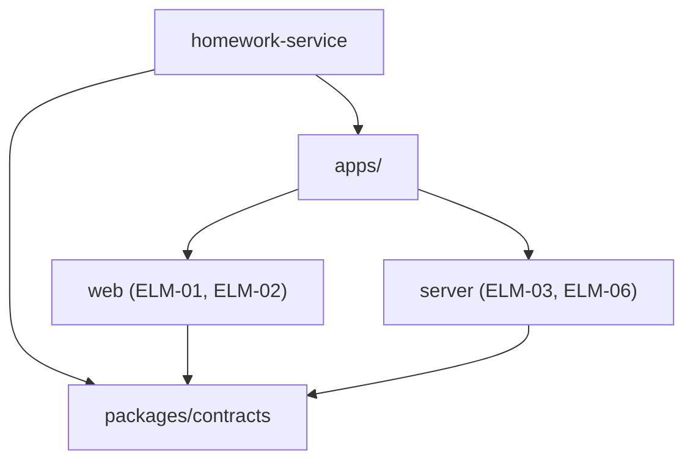
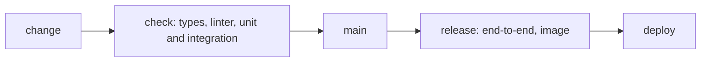

# Technical policy: Homework submission service

Status: answers applied · Updated: 2026-09-22 · Inputs as of: none · Stage 2b of 4

## Summary

One TypeScript repository: React for the web apps, Hono for the API server.

## Inputs
| Source | What it gave |
|---|---|
| 2-architecture.md | Elements and deployment |

## What was already decided
| Source | Fixes | Followed by |
|---|---|---|
| TC-01 | TypeScript | POL-01 |
| TC-04 | Web apps | POL-01 |

## Technical policies
<!-- generated: policies -->
| POL | Title | Scope | Addresses | Decisions | Basis |
|---|---|---|---|---|---|
| POL-01 | The stack of each kind of component | technology | DRV-06, DRV-07 | DEC-01, DEC-08 | inferred |
| POL-02 | One repository and its dependency rules | repository | DRV-06 | DEC-07 | inferred |
| POL-03 | Test layers and where the gates are checked | testing | DRV-01, DRV-03 | DEC-03 | inferred |
| POL-04 | The pipeline and the conventions inside the code | pipeline and code | DRV-06, DRV-07 | DEC-05 | inferred |
| POL-05 | How the spec of each kind of interface is made | specs | DRV-06 | DEC-08 | inferred |
| POL-06 | Feedback from implementation | implementation feedback | DRV-06 | — | inferred |
<!-- /generated -->

## Design decisions
<!-- generated: decisions -->
| DEC | Title | Addresses | Basis |
|---|---|---|---|
| DEC-07 | Keep every component in one repository | DRV-06 | inferred |
| DEC-08 | Write the API server with Hono on Node.js | DRV-02, DRV-07 | inferred |
<!-- /generated -->

## Repositories and directories

```text
homework-service/
  apps/web/
  apps/server/
  packages/contracts/
```



## Pipeline



## Gate bindings
<!-- generated: gate-bindings -->
| NFR | Title | Where | Bound in | Request instead |
|---|---|---|---|---|
| NFR-03 | Receipt E2E test | CI | POL-03 | — |
| NFR-04 | Test coverage of submission processing | Definition of Done | POL-03 | — |
| NFR-09 | Traceability in the Definition of Done | Definition of Done | POL-03 | — |
| NFR-10 | Double-check of grading | release check | POL-03 | — |
<!-- /generated -->

## Audit bindings
<!-- generated: audit-bindings -->
| NFR | Title | Placed in | Request instead |
|---|---|---|---|
| NFR-08 | Personal information audit | POL-03 | — |
| NFR-11 | Restore drill | POL-03 | — |
<!-- /generated -->

## Interface kinds
| Kind of interface | Seen in | Spec rule |
|---|---|---|
| HTTP | IFC-01, IFC-02 | From code |
| File | IFC-03 | Owner |
| Batch | IFC-04 | None |

## Findings
<!-- generated: findings -->
| FND | Title | Severity | Raised by | To | Status | Items changed |
|---|---|---|---|---|---|---|
<!-- /generated -->

## Hand-offs
<!-- generated: handoffs -->
| HND | Title | From | To | Component | Status | Decided in |
|---|---|---|---|---|---|---|
| HND-04 | How the CI jobs are arranged | architecture-to-technical-policy | implementation | ELM-03 | open | — |
<!-- /generated -->

## Decisions
| # | Question | Answer | Items |
|---|---|---|---|
| 1 | Which Node.js versions? | The Active LTS version (as drafted) | DAS-02 |

## Open assumptions
<!-- generated: assumptions -->
| ID | Title | Kind | Breadth | Severity | Items that depend on it |
|---|---|---|---|---|---|
<!-- /generated -->

## Placeholders

None.

## Open gaps

None.

## Out of scope

The content of the parents' screens (CHG-01).

## Next

Run architecture-to-high-level-design.
