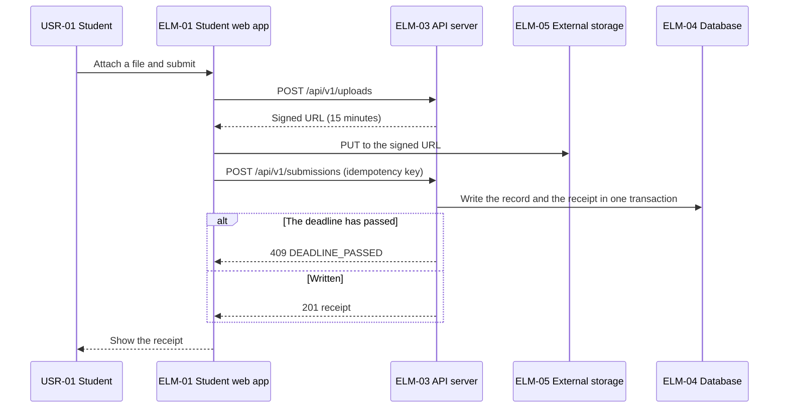
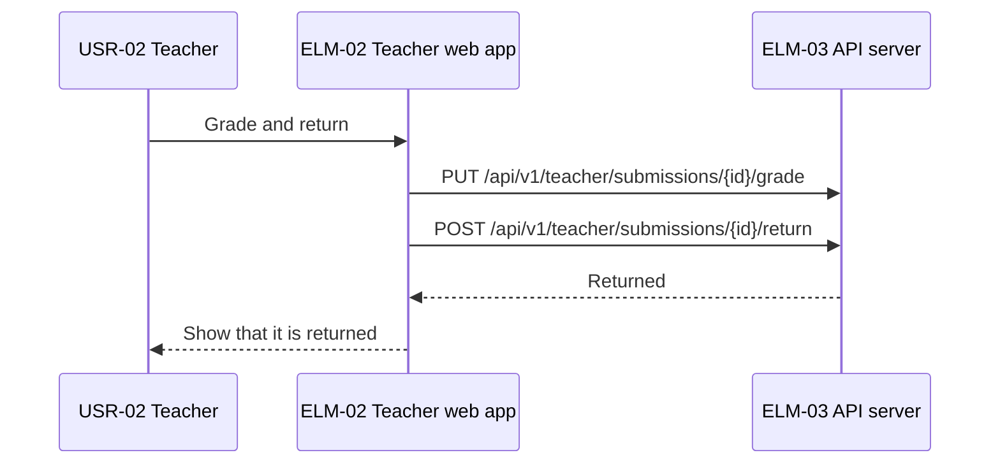
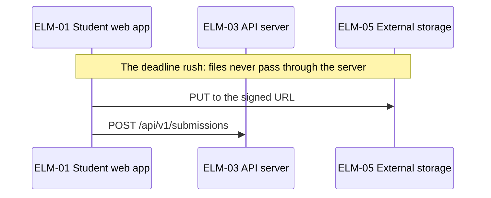
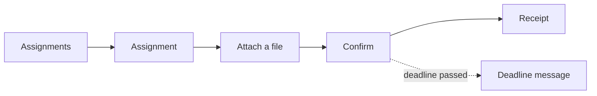
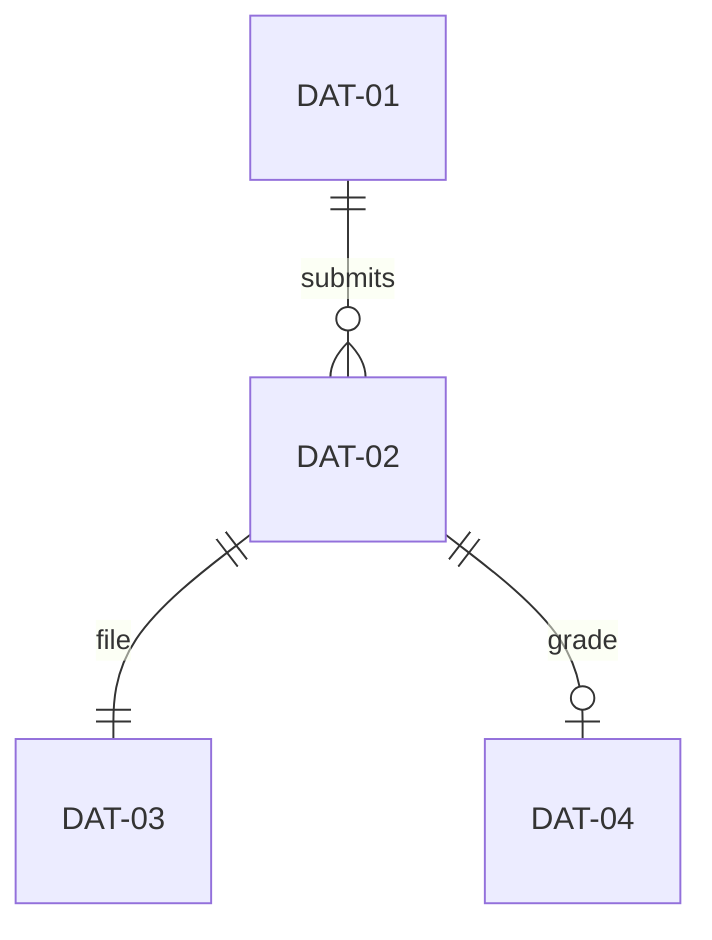
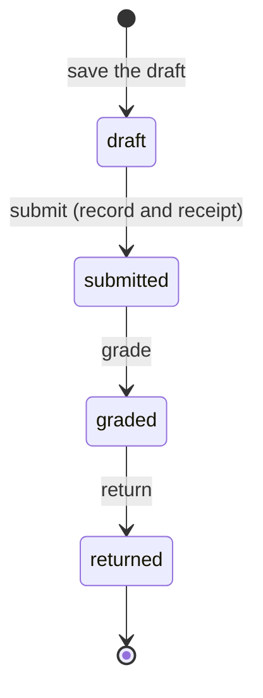

# High-level design: Homework submission service

Status: answers applied · Updated: 2026-09-25 · Inputs as of: none · Stage 3 of 4

## Summary

Four interfaces; the confirmation budget fits in 3 seconds.

## Inputs
| Source | What it gave |
|---|---|
| 2b-technical-policy.md | The technical policies |

## Shared conventions
| Convention | DEC |
|---|---|
| Errors are problem details with a code and a traceId | DEC-09 |
| An Idempotency-Key on every state-changing request | DEC-10 |

## Design decisions
<!-- generated: decisions -->
| DEC | Title | Addresses | Basis |
|---|---|---|---|
| DEC-09 | Return errors as problem details | IFC-01, IFC-02 | inferred |
| DEC-10 | State-changing requests carry an idempotency key | IFC-01, IFC-02, DRV-03 | inferred |
<!-- /generated -->

## Interfaces
<!-- generated: interfaces -->
| IFC | Title | Kind | Provider | Consumers | FRs | Spec | Basis |
|---|---|---|---|---|---|---|---|
| IFC-01 | Submission API | http | ELM-03 | ELM-01 | FR-01, FR-02, FR-04, FR-06 | HND-03 | inferred |
| IFC-02 | Grading API | http | ELM-03 | ELM-02 | FR-03, FR-05, FR-08 | HND-03 | inferred |
| IFC-03 | Files in the storage | file | ELM-05 | ELM-01, ELM-03 | FR-01 | — | inferred |
| IFC-04 | Nightly submission report | batch | ELM-06 | ELM-02 | FR-05, FR-09 | — | inferred |
<!-- /generated -->

## SLI bindings
<!-- generated: sli-bindings -->
| SLI | Title | Vantage | Bound on | Existing source | Request instead |
|---|---|---|---|---|---|
| SLI-01 | Submission availability | system-boundary | IFC-01 | OPF-02 | — |
| SLI-02 | Nightly report deadline | data | IFC-04 | OPF-02 | — |
<!-- /generated -->

## End-to-end flows

### CUJ-01 Submit homework

### CUJ-02 Grade and return

### DRV-01 Keep accepting submissions in the rush before a deadline

## Latency budgets and timeouts

### NFR-06 (SLI-01)

Measured from the browser sending the request to the receipt being shown.

| Hop | Budget (99th percentile, 4 hops) | Basis |
|---|---|---|
| ELM-01 sends the request | 0.30 s | Provisional |
| ELM-03 own work | 0.20 s | Provisional |
| Write the record and the receipt in ELM-04 (DEC-03) | 0.50 s | Provisional; the 99th percentile of the write |
| Back to the browser and shown | 0.50 s | Provisional |
| Margin | 1.50 s |  |
| Total | 3.00 s | NFR-06 threshold |

Failure paths and the error budget: failures during a storage outage count against NFR-01's budget.

### NFR-02 (SLI-02)

It starts at 02:00, with four hours to spare (DEC-04). Too few hops for a table.

### Timeouts
| Call path | Value (IFC) | Worst wait of the caller |
|---|---|---|
| ELM-01 → ELM-03 | 10 s (IFC-01) | 10 s |

## Screens

### CUJ-01 Submit homework

### CUJ-02 Grade and return

## Data

<!-- generated: data -->
| DAT | Title | Owner | Store | Classification | Basis |
|---|---|---|---|---|---|
| DAT-01 | Assignment | ELM-03 | ELM-04 | internal | inferred |
| DAT-02 | Submission | ELM-03 | ELM-04 | personal | inferred |
| DAT-03 | Submitted file | ELM-03 | ELM-05 | personal (students' answers) | inferred |
| DAT-04 | Grade | ELM-03 | ELM-04 | personal | inferred |
<!-- /generated -->

### Data quality flows
| Requirement | Comes from | Checked by | Passed on by, and how long it takes | Compared with |
|---|---|---|---|---|
| QR-07 | ELM-03 | Receipts against records every night | ELM-06, by the next morning | Receipts and records |

## States across elements

### Submission (DAT-02)

It becomes submitted only after the record is written (DRV-09).

## Acceptance criteria trace
<!-- generated: criteria -->
| FR | Criterion | IFCs | Flow |
|---|---|---|---|
| FR-01 | 1 | IFC-01, IFC-03 | CUJ-01 |
| FR-01 | 2 | IFC-01, IFC-03 | CUJ-01 |
| FR-02 | 1 | IFC-01 | CUJ-01 |
| FR-02 | 2 | IFC-01 | CUJ-01 |
| FR-03 | 1 | IFC-02 | CUJ-02 |
| FR-04 | 1 | IFC-01 | CUJ-03 |
| FR-05 | 1 | IFC-02, IFC-04 | CUJ-04 |
| FR-06 | 1 | IFC-01 | CUJ-01 |
| FR-08 | 1 | IFC-02 | CUJ-02 |
| FR-09 | 1 | IFC-04 | CUJ-04 |
<!-- /generated -->

## Findings
<!-- generated: findings -->
| FND | Title | Severity | Raised by | To | Status | Items changed |
|---|---|---|---|---|---|---|
<!-- /generated -->

## Hand-offs
<!-- generated: handoffs -->
| HND | Title | From | To | Component | Status | Decided in |
|---|---|---|---|---|---|---|
| HND-01 | How fast the storage answers a PUT | requirements-to-architecture-drivers | architecture-to-high-level-design | — | decided | IFC-03 |
| HND-03 | The schemas of the API requests and responses | architecture-to-high-level-design | implementation | ELM-03 | open | — |
<!-- /generated -->

## Decisions
| # | Question | Answer | Items |
|---|---|---|---|
| 1 | Which error shape? | Problem details (as drafted) | DEC-09 |

## Open assumptions
<!-- generated: assumptions -->
| ID | Title | Kind | Breadth | Severity | Items that depend on it |
|---|---|---|---|---|---|
<!-- /generated -->

## Placeholders

None.

## Open gaps

None.

## Out of scope

The content of the parents' screens (CHG-01).

## Next

Run high-level-design-to-detailed-design for each component.
