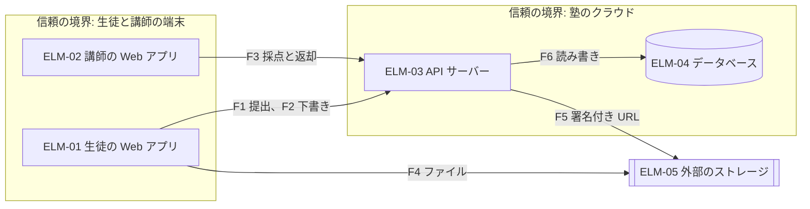
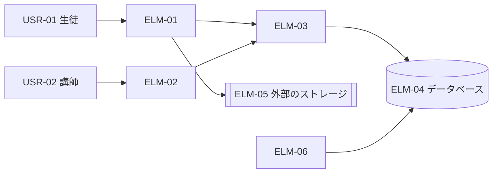
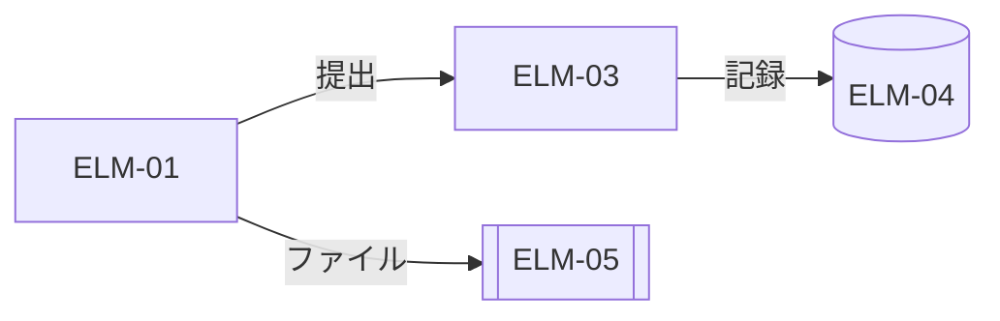
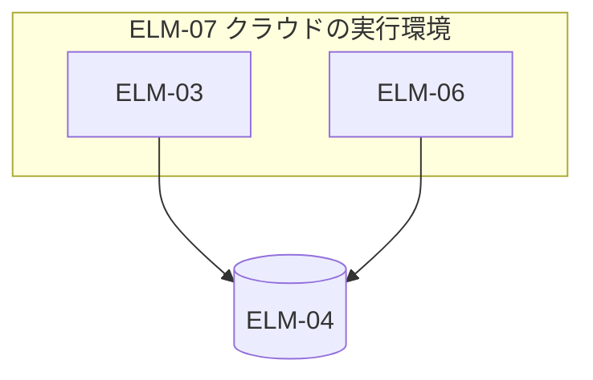
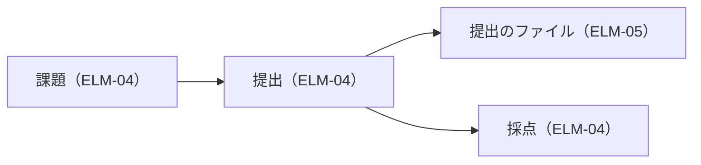

# アーキテクチャ: 課題提出サービス

状態: 回答反映済み · 更新: 2026-09-18 · 入力の基準: なし · 第 2 段階（全 4 段階）

## 概要

一つの API サーバーと二つの Web アプリ。ファイルはストレージに直接置く。

## 入力
| 出どころ | 得たもの |
|---|---|
| 1-architecture-drivers.md | 設計を動かす要求と順位 |

## 全体の構造

一つの API サーバー（ELM-03）が、二つの Web アプリ（ELM-01、ELM-02）からの要求を受ける。提出のファイルは署名付き URL で外部のストレージ（ELM-05）に直接置く（DEC-02）。

DEC-01 システムの分け方:
| 要求（順位） | 一つの API サーバーと、生徒と講師の Web アプリ | 機能ごとのサービス | サーバーレスの関数 |
|---|---|---|---|
| DRV-01（1） | 満たす | 満たす | 満たす |
| DRV-06（5） | 満たす | 満たさない | 一部 |

## 設計の決定
<!-- generated: decisions -->
| DEC | 名前 | 対象 | 根拠 |
|---|---|---|---|
| DEC-01 | 一つの API サーバーと二つの Web アプリにする | DRV-06、DRV-01、DRV-04 | 仮定 |
| DEC-02 | 提出のファイルを署名付き URL でストレージに直接置く | DRV-01、DRV-05、DRV-02 | 推定 |
| DEC-03 | 記録を書いてから受領を示す | DRV-03、DRV-09 | 推定 |
| DEC-04 | 夜間のレポートをバッチで作る | DRV-06、DRV-03 | 推定 |
| DEC-05 | トレース ID をブラウザで作って引き継ぐ | DRV-07 | 推定 |
| DEC-06 | 保護者向けの画面を生徒の Web アプリに置く | DRV-04、DRV-06 | 推定 |
<!-- /generated -->

DEC-02 ファイルの置き方:
| 要求（順位） | 署名付き URL で直接置く | サーバーが受けて置く |
|---|---|---|
| DRV-01（1） | 満たす | 満たさない |

## 設計の観点
| 観点 | 決めた決定、後の段階に残すもの、標準のやり方で足りる理由 |
|---|---|
| 並行性 | 同じ提出の送り直しは冪等キーで一つにする（第 3 段階が決める） |
| データの永続化 | 記録と受領を一つのトランザクションで書く（DEC-03、FND-01 を受けて） |
| エラー処理と障害許容 | ストレージの障害では提出を止め、もう一度試すよう示す |
| 可変性 | 保護者の画面は生徒の Web アプリに足す（DEC-06） |

## 脅威のモデル

守るもの: 生徒の答案、提出の記録、採点。

| 流れ | 越える境界 | なりすまし | 改ざん |
|---|---|---|---|
| F1 | 端末 → 塾のクラウド | 他人になりすまして提出する: セッション（DEC-01） | 期限を書き換える: サーバーが判定する |
| F2 | 端末 → 塾のクラウド | 他人の下書きを読む: 本人だけ（DRV-08） | — |
| F3 | 端末 → 塾のクラウド | 担当でない講師が採点する: 担当を確かめる（FND-02） | 点数を書き換える: 記録を残す |
| F4、F5 | 端末と塾のクラウド → 外部サービス | URL を盗んで置く: 15 分の期限（DEC-02） | — |
| F6 | 塾のクラウドの中 | — | — |

## 要素
<!-- generated: elements -->
| ELM | 名前 | 種類 | チーム | 今の構造との差分 |
|---|---|---|---|---|
| ELM-01 | 生徒の Web アプリ | コンポーネント | TEAM-01 | 新設 |
| ELM-02 | 講師の Web アプリ | コンポーネント | TEAM-01 | 新設 |
| ELM-03 | API サーバー | コンポーネント | TEAM-01 | 新設 |
| ELM-04 | データベース | データの置き場所 | TEAM-01 | 新設 |
| ELM-05 | 外部のストレージ | データの置き場所 | — | 新設 |
| ELM-06 | 夜間のバッチ | コンポーネント | TEAM-01 | 新設 |
| ELM-07 | クラウドの実行環境 | 実行環境 | TEAM-01 | 新設 |
<!-- /generated -->

## ビュー

### 外部との関係

### 実行時の構成

| つなぎ | 形 | 誰が誰を待つか |
|---|---|---|
| ELM-01 → ELM-03 | 要求と応答 | ELM-01 が 10 秒まで |
| ELM-03 → ELM-04 | 要求と応答 | ELM-03 が 2 秒まで |

### 配置

### 情報

## 通し確認

### CUJ

CUJ-01 課題の提出:
| 手順 | FR | 要素 | やり取り | 欠け |
|---|---|---|---|---|
| 課題を開く | FR-01 | ELM-01、ELM-03 | ELM-01 → ELM-03 課題の取得 | なし |
| ファイルを添付する | FR-01 | ELM-01、ELM-05 | ELM-01 → ELM-05 署名付き URL で置く | なし |
| 提出する | FR-01、FR-02 | ELM-01、ELM-03、ELM-04 | ELM-03 が記録を書いて受領を返す | なし |

CUJ-02 採点と返却:
| 手順 | FR | 要素 | やり取り | 欠け |
|---|---|---|---|---|
| 提出を開く | FR-03 | ELM-02、ELM-03、ELM-05 | ELM-02 → ELM-03 一覧と内容 | なし |
| 採点する | FR-03 | ELM-02、ELM-03 | 採点を保存する | なし |
| 返却する | FR-03、FR-08 | ELM-02、ELM-03 | 返却して通知する | なし |

CUJ-03 提出の失敗の調査:

知らせを受けた開発者が、トレース ID でログをたどり、原因を直す（DEC-05）。手順ごとの表にするほどの手順はない。

CUJ-04 月次の提出状況の確認:
| 手順 | FR | 要素 | やり取り | 欠け |
|---|---|---|---|---|
| レポートを開く | FR-05 | ELM-02、ELM-03、ELM-06 | 前の日までのレポート | なし |

### 主な設計を動かす要求
| DRV | 刺激が入る所 | 応答を形づくる決定 | 測定量を満たせるか | 残るリスク |
|---|---|---|---|---|
| DRV-01 | ELM-03 | DEC-01、DEC-02 | 満たす見込み | ストレージの障害 |
| DRV-03 | ELM-03 | DEC-03 | 満たす | なし |
| DRV-05 | ELM-01 | DEC-02 | 満たす | なし |
| DRV-02 | ELM-03 | DEC-03 | 満たす見込み（第 3 段階の予算） | 書き込みの遅れ |

## 設計上の値
<!-- generated: parameters -->
| 値 | DEC | 決めた所 |
|---|---|---|
| 署名付き URL の有効期限 | DEC-02 | DEC-02 |
| バッチの起動 | DEC-04 | DEC-04 |
<!-- /generated -->

## 技術的負債と先送り
| 項目 | 技術的負債か、確定の種類の先送りか | 決めた所 |
|---|---|---|
| DEC-04 | 負債: レポートは前の日までの分しか出ない | DEC-04 |
| HND-02 | 先送り: 保護者の画面の並び | DEC-06 |

## 費用と体制
| 費用のもと | 使う量 | 値段 |
|---|---|---|
| 実行環境 | 一つ、いつも | 月 1 万円 |
| ストレージ | 年 50 GB | 月 2 千円 |

- 2 人で作れる（PC-03）。

## 指摘
<!-- generated: findings -->
| FND | 名前 | 重さ | 出した段 | 宛先 | 状態 | 変えた項目 |
|---|---|---|---|---|---|---|
| FND-01 | 受領を記録より先に示している | 中 | design-review | architecture-drivers-to-architecture | 受け入れ | DEC-03 |
| FND-02 | トレース ID の引き継ぎがない | 軽微 | design-review | architecture-drivers-to-architecture | 受け入れ | DEC-05 |
<!-- /generated -->

## 申し送り
<!-- generated: handoffs -->
| HND | 名前 | 書いた段 | 宛先 | コンポーネント | 状態 | 決めた項目 |
|---|---|---|---|---|---|---|
| HND-02 | 保護者の画面の並び | architecture-drivers-to-architecture | high-level-design-to-detailed-design | ELM-01 | 未決定 | — |
<!-- /generated -->

## 決めたこと
| # | 質問 | 回答 | 項目 |
|---|---|---|---|
| 1 | トレース ID はどこで作るか | ブラウザ（下書きどおり） | DEC-05 |

## 未確認の仮定
<!-- generated: assumptions -->
| ID | 名前 | 種類 | 影響の広さ | 重大さ | 依存する項目 |
|---|---|---|---|---|---|
| DAS-01 | 同時に使う生徒は 300 人まで | 判断 | 中 | 低 | DEC-01 |
<!-- /generated -->

## 未定の値

なし。

## 未解決の点

なし。

## 範囲外

保護者向けの画面の中身（CHG-01）。

## 次

architecture-to-technical-policy を実行する。
