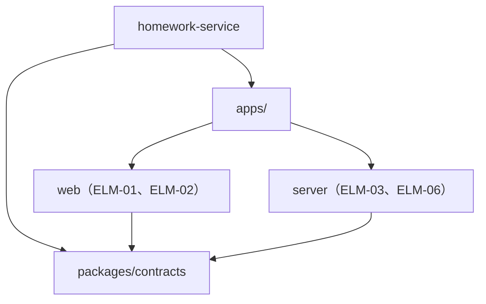
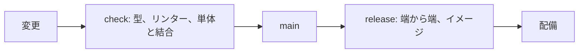

# 技術方針: 課題提出サービス

状態: 回答反映済み · 更新: 2026-09-22 · 入力の基準: なし · 第 2b 段階（全 4 段階）

## 概要

TypeScript の一つのリポジトリで、Web アプリは React、API サーバーは Hono で書く。

## 入力
| 出どころ | 得たもの |
|---|---|
| 2-architecture.md | 要素と配置 |

## すでに決まっていたこと
| 出どころ | 決めていること | 従う方針 |
|---|---|---|
| TC-01 | TypeScript | POL-01 |
| TC-04 | Web アプリ | POL-01 |

## 技術方針
<!-- generated: policies -->
| POL | 名前 | 範囲 | 対象 | 決定 | 根拠 |
|---|---|---|---|---|---|
| POL-01 | コンポーネントの種類ごとの技術の組み合わせ | 技術の選定 | DRV-06、DRV-07 | DEC-01、DEC-08 | 推定 |
| POL-02 | 一つのリポジトリと、その依存の規則 | リポジトリとディレクトリ | DRV-06 | DEC-07 | 推定 |
| POL-03 | テストの層とゲートの出どころ | テスト戦略とゲート | DRV-01、DRV-03 | DEC-03 | 推定 |
| POL-04 | パイプラインとコードの中の約束事 | CI/CD とコードの約束事 | DRV-06、DRV-07 | DEC-05 | 推定 |
| POL-05 | インタフェースの種類ごとの仕様書の作り方 | 仕様書の作り方 | DRV-06 | DEC-08 | 推定 |
| POL-06 | 実装からの戻り | 実装からの戻り | DRV-06 | — | 推定 |
<!-- /generated -->

## 設計の決定
<!-- generated: decisions -->
| DEC | 名前 | 対象 | 根拠 |
|---|---|---|---|
| DEC-07 | すべてのコンポーネントを一つのリポジトリに置く | DRV-06 | 推定 |
| DEC-08 | API サーバーは Node.js の上の Hono で書く | DRV-02、DRV-07 | 推定 |
<!-- /generated -->

## リポジトリとディレクトリ

```text
homework-service/
  apps/web/
  apps/server/
  packages/contracts/
```



## パイプライン



## ゲートの出どころ
<!-- generated: gate-bindings -->
| NFR | 名前 | 確かめる所 | 出どころの方針 | 代わりの要求 |
|---|---|---|---|---|
| NFR-03 | 受領の表示の E2E テスト | CI | POL-03 | — |
| NFR-04 | 提出の処理のテストの網羅 | 完成の定義 | POL-03 | — |
| NFR-09 | 失敗をたどれることの完成の定義 | 完成の定義 | POL-03 | — |
| NFR-10 | 採点の二重確認 | リリース前の確認 | POL-03 | — |
<!-- /generated -->

## 監査の置き場所
<!-- generated: audit-bindings -->
| NFR | 名前 | 置き場所の方針 | 代わりの要求 |
|---|---|---|---|
| NFR-08 | 個人情報の扱いの監査 | POL-03 | — |
| NFR-11 | 復元の訓練 | POL-03 | — |
<!-- /generated -->

## インタフェースの種類
| インタフェースの種類 | 現れる所 | 仕様書の決め方 |
|---|---|---|
| HTTP | IFC-01、IFC-02 | コードから生成する |
| ファイル | IFC-03 | 相手の文書 |
| バッチ | IFC-04 | 作らない |

## 指摘
<!-- generated: findings -->
| FND | 名前 | 重さ | 出した段 | 宛先 | 状態 | 変えた項目 |
|---|---|---|---|---|---|---|
<!-- /generated -->

## 申し送り
<!-- generated: handoffs -->
| HND | 名前 | 書いた段 | 宛先 | コンポーネント | 状態 | 決めた項目 |
|---|---|---|---|---|---|---|
| HND-04 | CI のジョブの並べ方 | architecture-to-technical-policy | implementation | ELM-03 | 未決定 | — |
<!-- /generated -->

## 決めたこと
| # | 質問 | 回答 | 項目 |
|---|---|---|---|
| 1 | Node.js の版の決まりは？ | Active LTS の版（下書きどおり） | DAS-02 |

## 未確認の仮定
<!-- generated: assumptions -->
| ID | 名前 | 種類 | 影響の広さ | 重大さ | 依存する項目 |
|---|---|---|---|---|---|
<!-- /generated -->

## 未定の値

なし。

## 未解決の点

なし。

## 範囲外

保護者向けの画面の中身（CHG-01）。

## 次

architecture-to-high-level-design を実行する。
