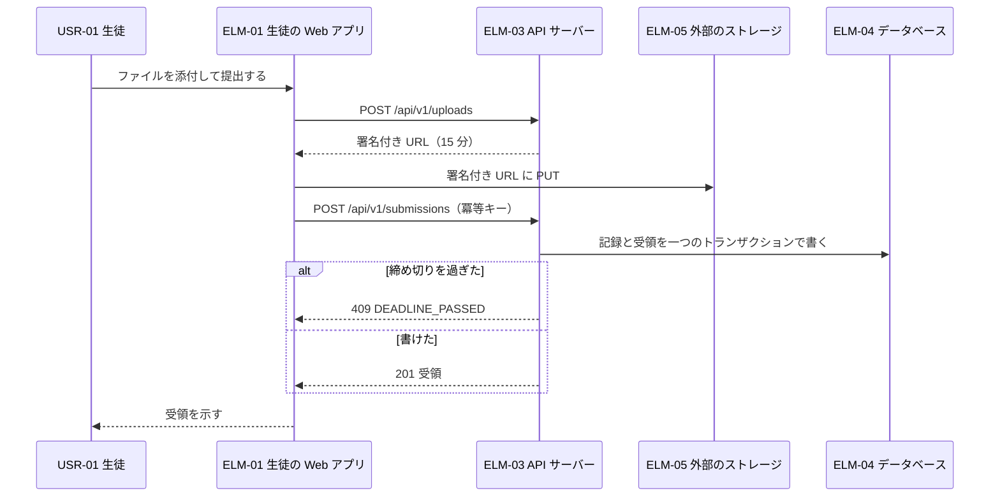
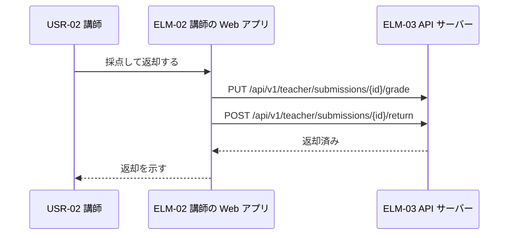
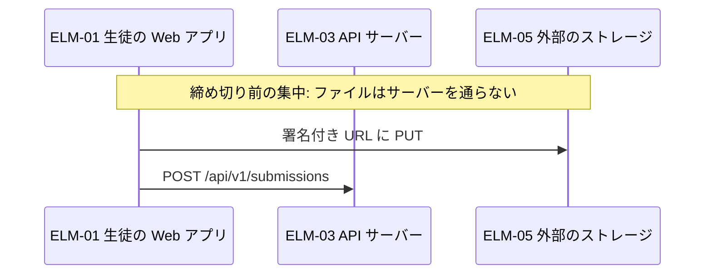
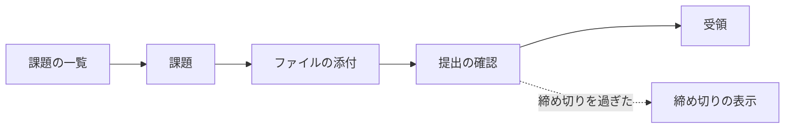
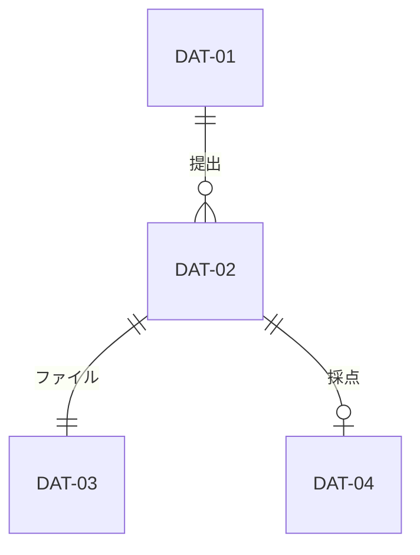
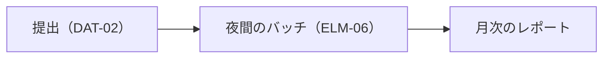
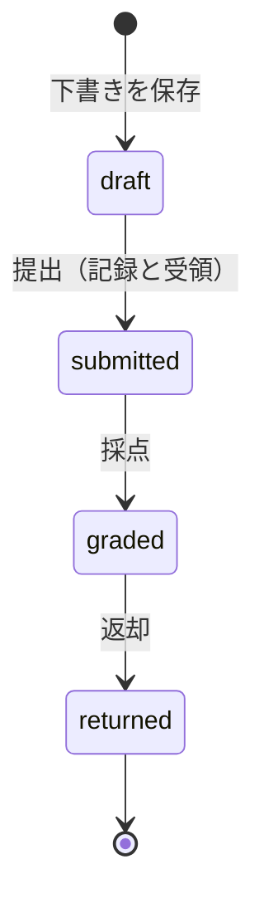

# 概略設計: 課題提出サービス

状態: 回答反映済み · 更新: 2026-09-25 · 入力の基準: なし · 第 3 段階（全 4 段階）

## 概要

インタフェースは四つ。確定の予算は 3 秒に収まる。

## 入力
| 出どころ | 得たもの |
|---|---|
| 2b-technical-policy.md | 技術方針 |

## 共通の約束事
| 約束事 | DEC |
|---|---|
| エラーは問題の詳細に code と traceId を足して返す | DEC-09 |
| 状態を変える要求すべてに Idempotency-Key | DEC-10 |

## 設計の決定
<!-- generated: decisions -->
| DEC | 名前 | 対象 | 根拠 |
|---|---|---|---|
| DEC-09 | エラーを問題の詳細の形で返す | IFC-01、IFC-02 | 推定 |
| DEC-10 | 状態を変える要求に冪等キーを求める | IFC-01、IFC-02、DRV-03 | 推定 |
<!-- /generated -->

## インタフェース
<!-- generated: interfaces -->
| IFC | 名前 | 種類 | 提供側 | 利用側 | FR | 仕様 | 根拠 |
|---|---|---|---|---|---|---|---|
| IFC-01 | 提出の API | HTTP | ELM-03 | ELM-01 | FR-01、FR-02、FR-04、FR-06 | HND-03 | 推定 |
| IFC-02 | 採点の API | HTTP | ELM-03 | ELM-02 | FR-03、FR-05、FR-08 | HND-03 | 推定 |
| IFC-03 | ストレージへのファイル | ファイル | ELM-05 | ELM-01、ELM-03 | FR-01 | — | 推定 |
| IFC-04 | 夜間の提出状況レポート | バッチ | ELM-06 | ELM-02 | FR-05、FR-09 | — | 推定 |
<!-- /generated -->

## SLI の出どころ
<!-- generated: sli-bindings -->
| SLI | 名前 | 見る位置 | 出どころの項目 | 既存の出どころ | 代わりの要求 |
|---|---|---|---|---|---|
| SLI-01 | 提出の可用性 | システムの境界 | IFC-01 | OPF-02 | — |
| SLI-02 | 夜間レポートの締め切り | データ | IFC-04 | OPF-02 | — |
<!-- /generated -->

## 端から端の流れ

### CUJ-01 課題の提出

### CUJ-02 採点と返却

### DRV-01 締め切り前の集中でも提出を受け付け続ける

## 遅延の予算とタイムアウト

### NFR-06（SLI-01）

測る区間は、ブラウザが送ってから受領を示すまで。

| ホップ（送ってから受領を示すまで） | 予算（99 パーセンタイル、4 ホップ） | もと |
|---|---|---|
| ELM-01 が要求を送る | 0.30 秒 | 仮 |
| ELM-03 の処理 | 0.20 秒 | 仮 |
| ELM-04 に記録と受領を書く（DEC-03） | 0.50 秒 | 仮。書き込みの 99 パーセンタイル |
| ブラウザに戻って示す | 0.50 秒 | 仮 |
| 余裕 | 1.50 秒 |  |
| 計 | 3.00 秒 | NFR-06 のしきい値 |

失敗したときの流れとエラーバジェット: ストレージの障害の間の失敗は NFR-01 のバジェットに入る。

### NFR-02（SLI-02）

02:00 に起動し、4 時間の余裕がある（DEC-04）。ホップの表にするほどのホップはない。

### タイムアウト
| 呼び出しの道 | 値（IFC） | 呼ぶ側が待つ最悪 |
|---|---|---|
| ELM-01 → ELM-03 | 10 秒（IFC-01） | 10 秒 |

## 画面

### CUJ-01 課題の提出

### CUJ-02 採点と返却

## データ

<!-- generated: data -->
| DAT | 名前 | 持ち主 | 置き場所 | 扱いの区分 | 根拠 |
|---|---|---|---|---|---|
| DAT-01 | 課題 | ELM-03 | ELM-04 | 社内 | 推定 |
| DAT-02 | 提出 | ELM-03 | ELM-04 | 個人情報 | 推定 |
| DAT-03 | 提出のファイル | ELM-03 | ELM-05 | personal（生徒の答案） | 推定 |
| DAT-04 | 採点 | ELM-03 | ELM-04 | 個人情報 | 推定 |
<!-- /generated -->

### データの品質の流れ
| 要求 | どこから来るか | どう確かめるか | どう伝わり、どれだけかかるか | 何と照らし合わせるか |
|---|---|---|---|---|
| QR-07 | ELM-03 | 毎晩、受領と記録を照らす | ELM-06、翌朝まで | 受領と記録 |

## 要素をまたぐ状態

### 提出（DAT-02）

submitted になるのは記録を書いた後だけ（DRV-09）。

## 受け入れ基準のたどり
<!-- generated: criteria -->
| FR | 基準 | IFC | 流れ |
|---|---|---|---|
| FR-01 | 1 | IFC-01、IFC-03 | CUJ-01 |
| FR-01 | 2 | IFC-01、IFC-03 | CUJ-01 |
| FR-02 | 1 | IFC-01 | CUJ-01 |
| FR-02 | 2 | IFC-01 | CUJ-01 |
| FR-03 | 1 | IFC-02 | CUJ-02 |
| FR-04 | 1 | IFC-01 | CUJ-03 |
| FR-05 | 1 | IFC-02、IFC-04 | CUJ-04 |
| FR-06 | 1 | IFC-01 | CUJ-01 |
| FR-08 | 1 | IFC-02 | CUJ-02 |
| FR-09 | 1 | IFC-04 | CUJ-04 |
<!-- /generated -->

## 指摘
<!-- generated: findings -->
| FND | 名前 | 重さ | 出した段 | 宛先 | 状態 | 変えた項目 |
|---|---|---|---|---|---|---|
<!-- /generated -->

## 申し送り
<!-- generated: handoffs -->
| HND | 名前 | 書いた段 | 宛先 | コンポーネント | 状態 | 決めた項目 |
|---|---|---|---|---|---|---|
| HND-01 | ストレージが PUT に答えるまでの時間 | requirements-to-architecture-drivers | architecture-to-high-level-design | — | 決定済み | IFC-03 |
| HND-03 | API の要求と応答のスキーマ | architecture-to-high-level-design | implementation | ELM-03 | 未決定 | — |
<!-- /generated -->

## 決めたこと
| # | 質問 | 回答 | 項目 |
|---|---|---|---|
| 1 | エラーの形は？ | 問題の詳細（下書きどおり） | DEC-09 |

## 未確認の仮定
<!-- generated: assumptions -->
| ID | 名前 | 種類 | 影響の広さ | 重大さ | 依存する項目 |
|---|---|---|---|---|---|
<!-- /generated -->

## 未定の値

なし。

## 未解決の点

なし。

## 範囲外

保護者向けの画面の中身（CHG-01）。

## 次

high-level-design-to-detailed-design を、コンポーネントごとに実行する。
